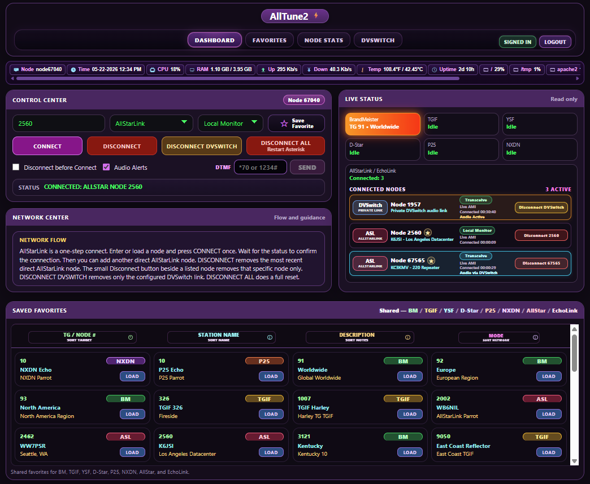
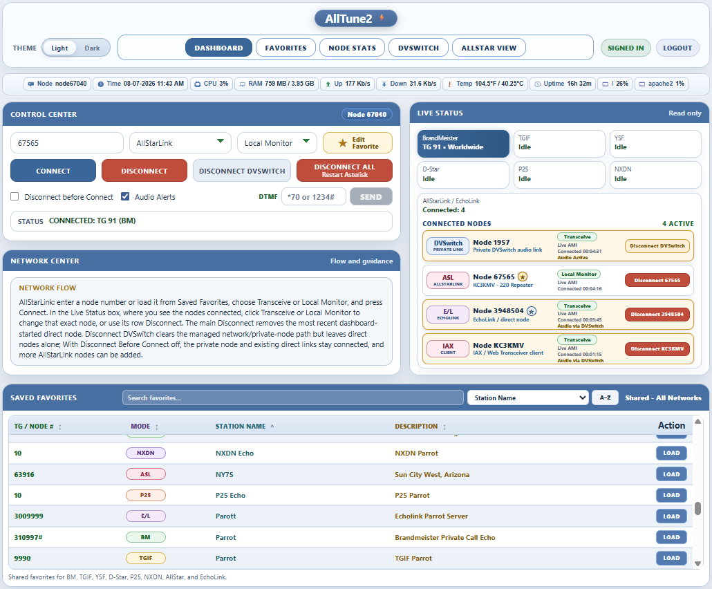

# AllTune2

### One dashboard for AllStarLink 3 and your digital networks

AllTune2 is a browser-based radio control center for **Debian 13 (ASL3)** on **ARM64/aarch64** (including compatible Raspberry Pi systems) and **AMD64/x86_64**. It lets you manage BrandMeister, TGIF, YSF, D-Star, P25, NXDN, AllStarLink, and EchoLink from one place, with saved Favorites, Live Status, spoken audio alerts, and Local Monitor / Transceive controls.

**AllTune2 does not replace AllStarLink, Asterisk, Analog_Bridge, or your existing DVSwitch installation.** BrandMeister uses the native **BMTD** backend and TGIF uses the native **TGIFD** backend. These paths do not use STFU, HBLink, or the old MMDVM_Bridge DMR sections. YSF, D-Star, P25, and NXDN still depend on your already-working DVSwitch / MMDVM_Bridge setup. M17 is not included.

<p align="center"><a href="screenshot.png"></a></p>
<p align="center"><em>Dark dashboard</em></p>

<p align="center"><a href="screenshot-light.png"></a></p>
<p align="center"><em>Light dashboard</em></p>

## Requirements

- A working **AllStarLink 3** node and a configured private digital-audio node.
- **Analog_Bridge** running with a working local audio path.
- Apache and PHP for the web dashboard.
- For **YSF, D-Star, P25, and NXDN**, the underlying DVSwitch/MMDVM_Bridge modes must already work before you enable them in AllTune2.
- Correct BrandMeister and/or TGIF credentials for the networks you use.

Do not change a working `/opt/MMDVM_Bridge/MMDVM_Bridge.ini` `[General] Id` just because BMTD and TGIFD use separate backends. Leave the existing ID alone if YSF, D-Star, P25, or NXDN are already working.

## Install

For a new installation:

```bash
cd /var/www/html
sudo git clone https://github.com/TerryClaiborne/alltune2.git alltune2
cd /var/www/html/alltune2
sudo ./setup_alltune2.sh
```

The installer detects architecture, selects the matching BMTD/TGIFD binaries, creates missing local config files from examples (preserving any that already exist), sets helper permissions and sudoers rules, configures Apache protections, and runs basic runtime checks. It may take longer on slower hardware such as a Raspberry Pi 3.

After setup, review and edit the live configuration files listed below before connecting.

## Update

For an ordinary application-code update:

```bash
cd /var/www/html/alltune2
sudo git pull origin main
```

If the update includes backend binaries, helpers, installer changes, Apache rules, permissions, or sudoers, run setup afterward:

```bash
cd /var/www/html/alltune2
sudo git pull origin main
sudo ./setup_alltune2.sh
```

## Apache Logging After ASL3 Updates

ASL3 appliance updates may replace Apache site configurations and remove shared access-log polling filters. After an ASL3 appliance update, rerun the AllTune2 installer to restore shared filtering while preserving normal request logging:

```bash
cd /var/www/html/alltune2
sudo ./setup_alltune2.sh
```

## Configure AllTune2

Live configuration lives under `/var/www/html/alltune2`. Replace the example values with your own node numbers, IDs, callsign, server, and credentials. Ordinary spaces around `=` are accepted, but keep embedded options such as `StartRef=9990;RelinkTime=60` intact and free of extra spaces.

| File | Purpose | Example file |
|---|---|---|
| `config.ini` | Main node, private digital node, optional networks, web login | `config.ini.example` |
| `bmtd/config/bmtd.ini` | BrandMeister credentials, BMTD identity, TLV ports | `bmtd/config/bmtd.ini.example` |
| `tgif/config/tgifd.ini` | TGIF security key, TGIFD identity, TLV ports | `tgif/config/tgifd.ini.example` |

### 1. Main settings — `config.ini`

File: `/var/www/html/alltune2/config.ini`

| Setting | Meaning | Example |
|---|---|---|
| `MYNODE` | Your public/main AllStarLink node | `"YOUR_NODE"` |
| `DVSWITCH_NODE` | Your private digital-audio node | `"YOUR_PRIVATE_NODE"` |
| `DSTAR_ENABLED` | Show D-Star only when it already works | `0` or `1` |
| `P25_ENABLED` | Show P25 only when it already works | `0` or `1` |
| `NXDN_ENABLED` | Show NXDN only when it already works | `0` or `1` |
| `ALLTUNE2_AUTH_ENABLED` | Optional web login (`1` = enabled) | `0` or `1` |
| `ALLTUNE2_ADMIN_USER` | Single admin username | `"admin"` |
| `ALLTUNE2_ADMIN_PASSWORD_HASH` | Password hash (never plaintext) | Created by setup |

Example starter block:

```ini
MYNODE="YOUR_NODE"
DVSWITCH_NODE="YOUR_PRIVATE_NODE"
DSTAR_ENABLED=0
P25_ENABLED=0
NXDN_ENABLED=0
ALLTUNE2_AUTH_ENABLED=0
ALLTUNE2_ADMIN_USER="admin"
ALLTUNE2_ADMIN_PASSWORD_HASH=""
```

Enable D-Star, P25, or NXDN only after those modes already work on your base system.

### 2. BrandMeister — `bmtd.ini`

File: `/var/www/html/alltune2/bmtd/config/bmtd.ini`

Change only the station-specific values. Do not remove other sections from the supplied example.

| Section | Setting | Purpose / example |
|---|---|---|
| `[brandmeister]` | `host` | BrandMeister master, e.g. `3104.repeater.net` |
| `[brandmeister]` | `port` | Typically `54006` |
| `[brandmeister]` | `password` | BrandMeister Hotspot Security / SelfCare password |
| `[identity]` | `dmr_id` | Your base/gateway DMR ID |
| `[identity]` | `hotspot_radio_id` | Your BrandMeister hotspot ID |
| `[identity]` | `callsign` | Your callsign |
| `[private_node]` | `mynode` | Must match `MYNODE` in `config.ini` |
| `[private_node]` | `private_node` | Must match `DVSWITCH_NODE` in `config.ini` |
| `[private_node]` | `autoload_mode` | Normally `transceive` |
| `[tlv]` | `rx_port` / `tx_port` | Example `31103` / `31100` — keep unless your Analog_Bridge ports differ |

Representative values (not a complete replacement file):

```ini
[brandmeister]
host=3104.repeater.net
port=54006
password=YOUR_BRANDMEISTER_HOTSPOT_PASSWORD

[identity]
dmr_id=YOUR_DMR_ID
hotspot_radio_id=YOUR_BRANDMEISTER_HOTSPOT_ID
callsign=YOUR_CALLSIGN

[private_node]
mynode="YOUR_ALLSTAR_NODE"
private_node="YOUR_DVSWITCH_NODE"
autoload_mode=transceive

[tlv]
rx_port=31103
tx_host=127.0.0.1
tx_port=31100
```

BrandMeister hotspot ID is typically your base DMR ID plus a suffix (example: base `3220008` → hotspot `322000811`). Use the ID actually registered for your BrandMeister connection. Do not reuse the TGIFD hotspot ID unless it is also correct for BrandMeister.

### 3. TGIF — `tgifd.ini`

File: `/var/www/html/alltune2/tgif/config/tgifd.ini`

Change only the station-specific values. Preserve the remaining sections.

| Section | Setting | Purpose / example |
|---|---|---|
| `[identity]` | `callsign` | Your callsign |
| `[identity]` | `dmr_id` | Your base/gateway DMR ID |
| `[identity]` | `hotspot_radio_id` | TGIF hotspot ID; often BrandMeister hotspot ID + 1 |
| `[tgif]` | `security_key` | TGIF Hotspot Security Key (not website password) |
| `[tgif]` | `startup_tg` | Example `9990` or `9050` |
| `[tgif]` | `options` | Matching reflector string, e.g. `StartRef=9990;RelinkTime=60` |
| `[private_node]` | `mynode` / `private_node` | Must match `config.ini` |
| `[private_node]` | `autoload_mode` | Normally `transceive` |
| `[tlv]` | `inbound_slot` | Keep `2` |
| `[mmdvm]` | `slots` | Keep `2` (metadata only; not an MMDVM_Bridge dependency) |

Representative values:

```ini
[identity]
callsign=YOUR_CALLSIGN
dmr_id=YOUR_GATEWAY_DMR_ID
hotspot_radio_id=YOUR_TGIF_HOTSPOT_ID

[tgif]
security_key="YOUR_TGIF_HOTSPOT_SECURITY_KEY"
startup_tg=9990
options=StartRef=9990;RelinkTime=60

[private_node]
mynode="YOUR_ALLSTAR_NODE"
private_node="YOUR_DVSWITCH_NODE"
autoload_mode=transceive

[tlv]
rx_port=31103
tx_host=127.0.0.1
tx_port=31100
inbound_slot=2

[mmdvm]
slots=2
```

When changing the startup talkgroup, keep `startup_tg` and the `StartRef` value inside `options` consistent.

### Backends and architectures

| Network | ARM64/aarch64 binary | AMD64/x86_64 binary |
|---|---|---|
| BrandMeister (BMTD) | `bmtd/bin/bmtd` | `bmtd/bin/bmtdamd` |
| TGIF (TGIFD) | `tgif/bin/tgifd` | `tgif/bin/tgifdamd` |

The installer selects the correct binary for the machine. Both binaries are required whenever private native backend code changes.

## Open the dashboard

On your local network:

```text
http://YOUR_NODE_IP/alltune2/public/
```

For remote access, prefer Tailscale or another VPN you control. If you expose the dashboard publicly, use a hostname or DDNS name with a trusted HTTPS certificate (for example Let’s Encrypt) and keep web login enabled. A DDNS name alone does not create a trusted certificate.

## Web login and security

AllTune2 can run without login (`ALLTUNE2_AUTH_ENABLED=0`) or with a single-admin password (`ALLTUNE2_AUTH_ENABLED=1`). When login is enabled, logged-out users see the dashboard, status, and Favorites in View Only mode; connect, disconnect, DTMF, and Favorites editing require sign-in.

Set or change the password (the script stores a hash, never plaintext):

```bash
sudo /var/www/html/alltune2/setup_alltune2.sh --set-admin-password
```

Disable login when appropriate for a controlled private network:

```bash
sudo /var/www/html/alltune2/setup_alltune2.sh --disable-auth
```

Normal setup and update leave existing authentication settings unchanged. The installer also applies Apache protections that block direct browser access to config, log, helper, and data files while allowing the public dashboard and API.

## Using AllTune2

1. Select the network and choose **Transceive** or **Local Monitor** where applicable.
2. Enter a target manually or load a Favorite.
3. Press **Connect** and confirm in Live Status.
4. Use **Disconnect**, **Disconnect DVSwitch**, or **Disconnect All** as needed.

| Network | Target and notes |
|---|---|
| **BrandMeister** | Talkgroup number or Favorite. Private calls: append one `#` to a DMR ID. Select another TG and Connect to change. |
| **TGIF** | Talkgroup number or Favorite. Select another TG and Connect to change. |
| **YSF** | Room or reflector that already works on the base system. |
| **D-Star** | Reflector; requires `DSTAR_ENABLED=1` and a working base mode. |
| **P25** | Destination; requires `P25_ENABLED=1` and a working base mode. |
| **NXDN** | Destination; requires `NXDN_ENABLED=1` and a working base mode. |
| **AllStarLink** | Node number. Additional direct AllStarLink connections can be stacked. |
| **EchoLink** | Mapped target: `3` + six-digit EchoLink node (example `3001234`). |

**EchoLink safeguards:** AllTune2 allows only one dashboard-initiated outbound EchoLink direct link at a time. Incoming EchoLink connections are not limited by this rule. An outbound mode change can be blocked while another EchoLink connection is active to avoid interrupting it or triggering unsafe resets.

### Connected nodes and modes

In **Live Status → Connected Nodes**, click the **Transceive** or **Local Monitor** label on an eligible AllStarLink, EchoLink, or private DVSwitch row to change the mode on your side (including incoming links). Local Monitor lets you hear the remote station without sending your transmitted audio back. Raw IAX channels, Web Transceiver connections, and named app_rpt/IAX clients do not have this control.

**Disconnect DVSwitch** removes the private digital-audio link without restarting Asterisk. **Disconnect All** performs a broader reset and restarts Asterisk.

Spoken browser alerts announce supported connect and disconnect events. When the standalone AllStar View application is installed, a navigation button appears.

### Favorites

Search, sort, save, edit, and load Favorites for any supported network. The dashboard **Save Favorite** button detects an existing entry with the same target and mode so you can update it instead of creating a duplicate.

When an AllStarLink or EchoLink node is connected, a star appears in Live Status:
- `☆` — not yet saved; click to add it.
- `★` — already saved; click to edit it.

Your personal list is stored at `/var/www/html/alltune2/data/favorites.txt`. A neutral example is provided at `data/favorites.example.txt`. Do not commit your live Favorites file.

## Troubleshooting

| Problem | Check first |
|---|---|
| **BrandMeister does not connect** | `config.ini`, `bmtd/config/bmtd.ini`, `logs/bmtd.log`. Run `sudo /var/www/html/alltune2/bmtd/alltune2-bmtd-helper.sh status`. Verify host, port, password, DMR ID, and hotspot ID. |
| **TGIF does not connect or inbound audio is unreliable** | `tgif/config/tgifd.ini`, `logs/tgifd.log`. Run `sudo /var/www/html/alltune2/tgif/alltune2-tgifd-helper.sh status`. Confirm `security_key`, IDs, `startup_tg`/`options`, and `[tlv] inbound_slot=2`. |
| **YSF / D-Star / P25 / NXDN missing** | Confirm the base MMDVM_Bridge/DVSwitch mode works, the enable flag is set, node values are correct, and `/opt/MMDVM_Bridge/dvswitch.sh` exists. |
| **Choppy or broken audio** | Restart Analog_Bridge after disconnecting active calls: `sudo systemctl restart analog_bridge`. |
| **Login not working** | Review the auth lines in `config.ini` and use `--set-admin-password`. Do not hand-edit the hash. |
| **HTTPS certificate warning** | Confirm the browser hostname matches the certificate and that ports 80/443 reach the node rather than the router. |
| **After an update** | Check the release notes. Rerun `sudo ./setup_alltune2.sh` if helpers, binaries, permissions, or Apache rules changed. |

### Keep your local data private

Do not commit live configuration, credentials, state, or personal Favorites:

- `/var/www/html/alltune2/config.ini`
- `/var/www/html/alltune2/bmtd/config/bmtd.ini`
- `/var/www/html/alltune2/tgif/config/tgifd.ini`
- `/var/www/html/alltune2/data/favorites.txt`

Do not change these underlying files unless required for your already-working DVSwitch system: `/opt/Analog_Bridge/Analog_Bridge.ini`, `/opt/MMDVM_Bridge/DVSwitch.ini`, `/opt/MMDVM_Bridge/MMDVM_Bridge.ini`.

---

**Release history and upgrade-specific notes are documented with each [GitHub release](https://github.com/TerryClaiborne/alltune2/releases).**

**Contact:** [kc3kmv@yahoo.com](mailto:kc3kmv@yahoo.com)
